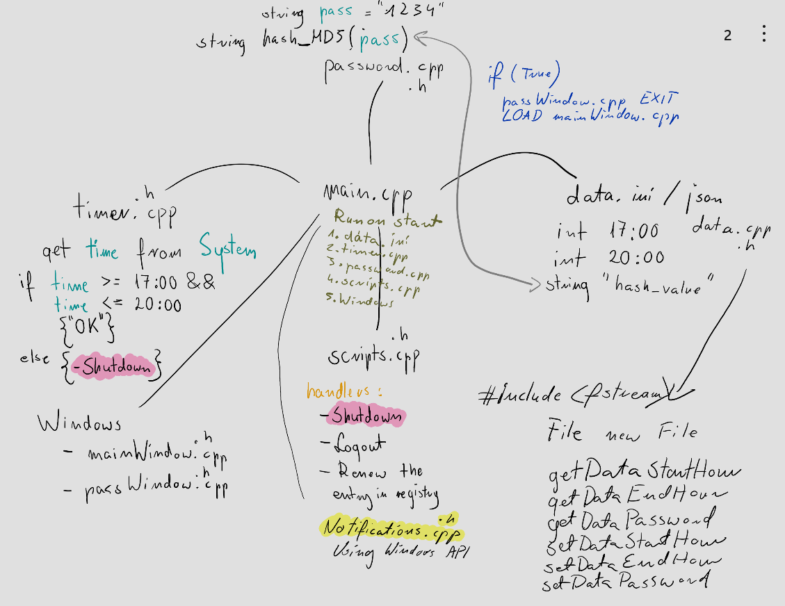

# Dev notes

Easy app that would have straight construction. 
It would be log out the all users of one computer it user use the app beside restricted hours. 
It can be done with powershell but I would add a little c++ console for this program. 
There is two approaches for this app.

- All in powershell and add the executable tasks to task scheduler

- Powershell converted into c++ code and executable as separate program that must be added to registry and startup apps.

I would use the second approach, it will be slower but I would have a little fun with c++ coding.

## How to start

1. [x] Start from creating a simplest helloworld program. C++ code connected to powershell print(helloworld) script.

2. [x] Add this executable to registry and startup apps.
 
3. [x] See if it works on the start of the computer.

4. [x] Make the structure of the program.

5. [x] Add the timer functionality.

6. [x] Add the entry in registry functionality.
   HKEY_CURRENT_USER\Software\Microsoft\Windows\CurrentVersion\Run
   (There is entry about the program)

7. [x] Add the data.ini functionality.

8. [x] Notifications.

## Approaches

### Ways to manage the user access blocker:

1. [x] **Auto-logout/Shutdown when run program at startup registry path to program or startup folder.** *It is propably needed anyway*
    - Press Win + R, type **shell:startup**, and press Enter. This opens the Startup folder.
    - Create a shortcut of your compiled .exe file (your project app) inside this folder.
    - Your app will automatically launch when the user logs in.
    - **
OR
**
    - Press Win + R, type regedit, and press Enter to open the Registry Editor.
    - Navigate to the following registry key: HKEY_CURRENT_USER\Software\Microsoft\Windows\CurrentVersion\Run
    - Right-click in the right pane and select New > String Value.
    - Name it as your app.
    - Set its value to the full path of your executable (e.g., C:\path\to\your\app.exe).
  
2. [x] **Password dialog on the start with Countdown timer.**
    - Get the time from system.
    - Calculate it with the allowed time.
    - If user logged beside the allowed time there is countdown timer and shutdown.
    - There is password dialog that would allow to bypass the shutdown.
  
3. **Task Scheduler Integration with C++.**
    - You can invoke the Windows schtasks command-line utility from your C++ program using *system("schtasks /create /tn \"MyTask\" /tr \"C:\\path\\to\\app.exe\" /sc onlogon /rl highest");*
    - **
OR
**
    - Using Task Scheduler COM API (Native C++)
    - Requires initializing COM, creating TaskService object, configuring triggers (e.g., on logon, daily), specifying actions (like running your executable), and registering the task.
  
4. **Login restrictions using Local Security Policy on Windows Pro and Enterprise.**
    - Win + R type **secpol.msc** and press Enter.
    - Navigate to Local Policies > User Rights Assignment.
    - Here there are policies like *Allow log on locally*, *Deny log on locally*, *Deny log on through Remote Desktop Services*
    - Settings can be viewed or changed programmatically via Windows APIs or PowerShell cmdlets.
  
5. Block from BIOS/UEFI settings. :O

### Ways to add the notifications:

1. **Simple Message Box (*too much easy*)**
2. **Modern Windows 10/11 Toast Notification / Toast Notification without external module** (*Issues, the provided docs is for VS compiler.
   It requires the proper App User Model ID (AUMID) registrated in Windows.*)
   *https://learn.microsoft.com/en-us/windows/apps/develop/notifications/app-notifications/send-local-toast-cpp-uwp?tabs=builder-syntax*
3. [x] **Using Windows API directly**

### Other:

1. SetData function in Data.cpp should not ask the user for the input, in that case it
cannot be tested, and this approach is not right. Std::cin should be moved to UI or main.cpp.

## Structure

## TODO

- [x] Understand the Registry handler
- [ ] Understand the Notifications handler
- [ ] Add proper Shutdown and log out functionality.
- [x] Connect it all to the main.cpp
- [ ] Then try to make simple GUI.
- [ ] Password encryption handler.
- [x] THERE IS EXACT PROBLEM EVERYTIME I RUN ANY PASSWORD WITH 5 signs.
  (There were problems with the way how the password is saved, I changed it to char array that has constant size
   and its own constatn address in memory.)
- [ ] Problem with the path and registry save, Fuction of saving to registry needs to know
   where the program is located.
- [ ] There should be backdoor if user logged outside allowed hours, for example
   before the shutdown procedure there could be password dialog that would allow to bypass the shutdown.
- [ ] Program should hard to shutdown, if user exit from main window, it should still
   work as a background application.

## AI participation in the project

1. Notifications.cpp/.h is fully AI-written.
2. Data.cpp getFileName() is fully AI-written.
2. Scripts.cpp/.h (scriptHandler() and addToStartup()) is written by AI and modified and understood by me.
3. Tests are written with the help of the video https://www.youtube.com/watch?v=_MhbaVtcrR0&t=1827s
4. Data.cpp setData() is written with the help of the video https://www.youtube.com/watch?v=QrQOrqPI6z4&t=40s
5. Data.cpp saveData(), loadData() are written with the help of the video https://www.youtube.com/watch?v=tyXq2d5g8-0
6. Rest if written by Byniu5™ and by using AI tools in CLion.